# Claims Platform

## Contents

1. [Project Title](#1-project-title)
2. [Project Overview](#2-project-overview)
3. [Key Features](#3-key-features)
4. [Technology Stack](#4-technology-stack)
5. [Architecture](#5-architecture)
6. [Docker Setup](#6-docker-setup)
7. [Claim Lifecycle and Flows](#7-claim-lifecycle-and-flows)
8. [Installation and Setup](#8-installation-and-setup)
9. [Configuration](#9-configuration)
10. [API Documentation](#10-api-documentation)
11. [Running the Application](#11-running-the-application)
12. [Testing](#12-testing)
13. [Error Handling](#13-error-handling)
14. [Logging and Monitoring](#14-logging-and-monitoring)
15. [Security](#15-security)
16. [Troubleshooting](#16-troubleshooting)
17. [Future Enhancements](#17-future-enhancements)
18. [Contribution Guidelines](#18-contribution-guidelines)
19. [License](#19-license)

## 1. Project Title

**Claims Platform** (`claims-platform` 1.0.0-SNAPSHOT): motor and property claims for six markets, from first notice of loss to payment.

## 2. Project Overview

A customer reports an incident. The platform checks the policy, stores the claim, and moves it through assessment, approval and payment. Claim managers work any claim in their markets: one proposes the decision, a second one approves it.

Markets are Singapore, Hong Kong, Malaysia, Thailand, Indonesia, and Australia. The public address is the gateway. After a local start, open **http://localhost:8000**.

| UI address | What it is |
|---|---|
| http://localhost:8000 | Portal through the gateway: the address to use |
| http://localhost:8000/claims | Customer portal: my claims, report a claim, messages, settings |
| http://localhost:8000/work | Claim manager portal: work queue, claim workspace, approvals, insights |
| http://localhost:3000 | Portal container directly, without the gateway |
| http://localhost:5173 | Vite dev server with hot reload (`npm run dev`), forwards API calls to the gateway |

After sign-in, the portal opens `/claims` for a customer and `/work` for a claim manager.

### Claim Overview

Every claim status, and who moves the claim on: the customer, a claim manager, or the platform (payment results and auto-close).

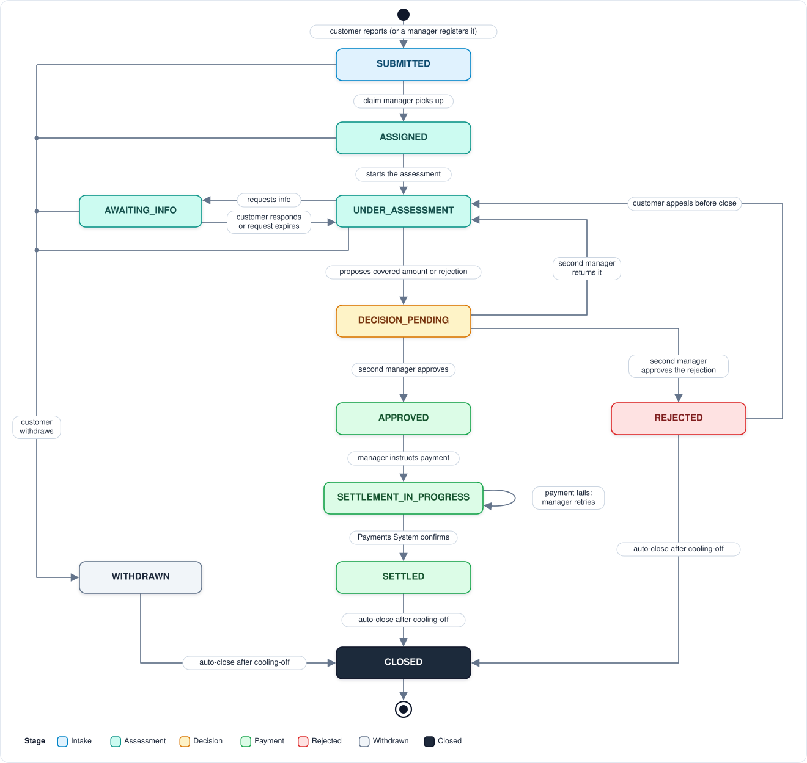

### Words used in this README

| Word | Meaning |
|---|---|
| Customer | Role `CUSTOMER`. Reports and follows their own claims on `/claimant/v1/**`. |
| Claim manager | Role `CLAIMS_ADJUSTER`, the only staff role. Works any claim in the markets on their token, on `/staff/v1/**` and `/admin/v1/**`. |
| Second claim manager | Any other claim manager. Every proposed decision waits for one; nobody approves their own proposal. |
| Platform | Work nobody does by hand: the outbox relay, scheduled jobs and the event consumers. |

## 3. Key Features

- First notice of loss for motor and property, with document upload and an `Idempotency-Key` against double submits.
- Policy cover check with a 2 s timeout. If the Policy System is down, the claim is still saved with cover `PENDING` and a job retries.
- Work queue, assignment, assessment and information requests for claim managers.
- Decisions for full or partial cover, or rejection. Every decision is approved by a second claim manager.
- Payments over Kafka, with retry after a failed payment and a signed webhook fallback.
- Customer withdraw (before a decision) and appeal (after a rejection, until the claim closes).
- Insights: work queue, search, approvals, workload, performance, SLA and exposure dashboards, and SLA alerts.
- In-app, e-mail, SMS and push notifications in six languages, with customer preferences and editable templates.
- Optimistic locking on every staff change (`If-Match` / `ETag`).

## 4. Technology Stack

| Layer | Choice |
|---|---|
| Language | Java 21 |
| Services | Spring Boot 3.4.5, Spring Security, Spring MVC |
| Gateway | Spring Cloud Gateway Server MVC (`2024.0.3`), Resilience4j, Bucket4j |
| Data | PostgreSQL 16, Flyway, JDBC (`JdbcClient`); Spring Data JPA for notification reference data |
| Messaging | Apache Kafka (Redpanda locally), transactional outbox |
| Caching | Caffeine, in-process (no Redis) |
| API docs | springdoc OpenAPI 2.8.6 |
| UI | React 18, TypeScript 5.6, Vite 5, React Router 6 |
| Tests | JUnit 5, Mockito, Testcontainers, Vitest, Bruno |
| Build | Maven wrapper, npm |

## 5. Architecture

The diagrams are SVG files in `documents/images/`.

### Activity diagram

Every activity from report to close. Box colour shows who acts, diamonds are decisions, the dashed line is the customer's option to withdraw.

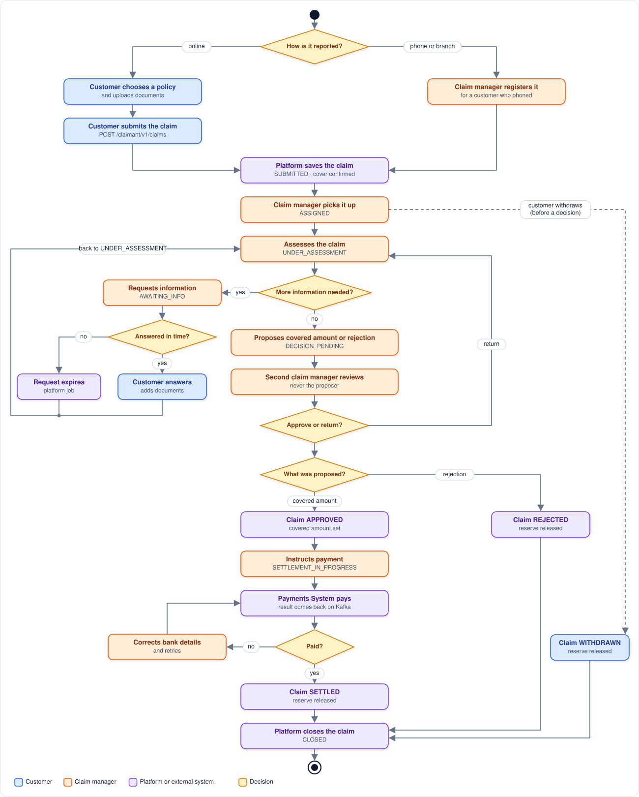

"Return" sends the claim back to `UNDER_ASSESSMENT`. A rejected claim closes after the cooling-off period.

### Swimlane diagram

Who does each step. The third lane holds what nobody does by hand: platform jobs and the external Payments System.

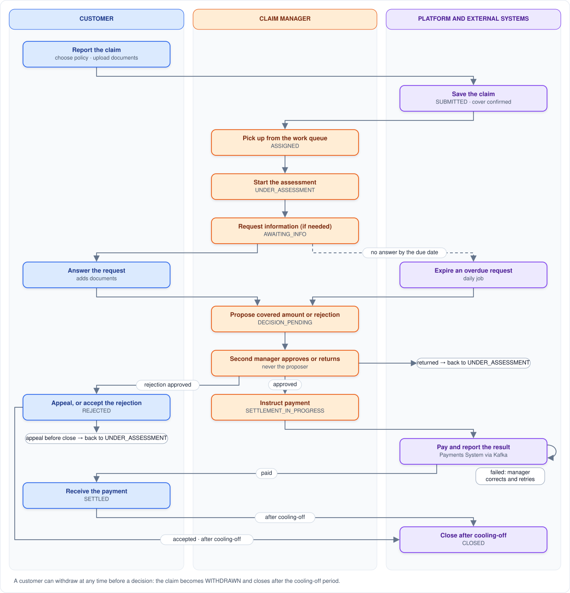

| Role | Responsible for |
|---|---|
| Customer | Reporting, documents, answering questions, withdrawing, appealing |
| Claim manager | Work queue, assessment, information requests, proposing decisions, approving another manager's decision, payments |
| Platform and external systems | Saving the claim, expiring requests, paying, notifications, SLA alerts, auto-close |

### System context

Who uses the platform, the services it is made of, and the outside systems it talks to.

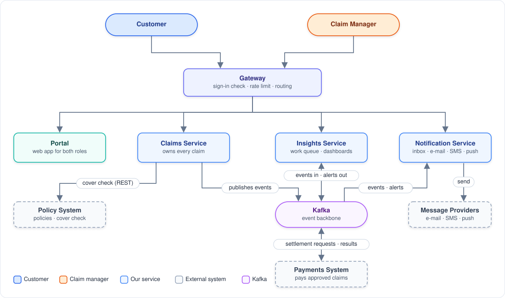

| Part | Folder | Job |
|---|---|---|
| Gateway | `gateway-service` | The only way in. Checks the token and the role for the path, rate-limits, circuit-breaks each upstream and forwards the call. |
| Portal | `claims-ui` | One web app for customers and claim managers. |
| Claims Service | `claims-service` | Owns every claim; the only service that creates or changes one. Also sign-in and document uploads. |
| Insights Service | `insights-service` | Work queue, search, approvals and dashboards, built from claim events. Raises SLA alerts. |
| Notification Service | `notification-service` | Turns claim events and SLA alerts into inbox messages, e-mail, SMS and push. Holds preferences and templates. |
| Shared library | `claims-common` | Event contracts, security, the error format and the Kafka retry policy used by every service. |
| Kafka | — | Carries events between services. Services never call each other directly. |
| Policy System | `deployment/docker/policy-system` (local stub) | External. Lists a customer's policies and answers cover checks over REST. |
| Payments System | `payments-simulator` (local stand-in) | External. Pays approved claims and reports the result over Kafka. |
| Message providers | — | External. Deliver e-mail, SMS and push (faked locally). |

Supporting folders: `deployment` (Compose files, `.env.example`, image recipe, `smoke.sh`) and `bruno` / `http` (API collections that walk the business flow).

### Gateway

Every call goes through `gateway-service`. It stops bad requests early and routes the rest; the first matching route wins.

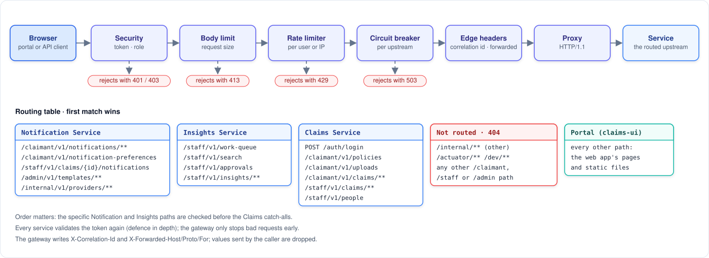

| Step | What it does | Rejects with |
|---|---|---|
| Security | Validates the JWT and the role for the path | 401 / 403 |
| Body limit | Refuses oversized requests | 413 |
| Rate limiter | Per token `sub`, else per client IP | 429 |
| Circuit breaker | One per upstream; 502/503/504 and exceptions count as failures; no retries | 503 |
| Edge headers | Sets `X-Correlation-Id` and `X-Forwarded-Host/Proto/For` (caller values are dropped) | — |
| Proxy | JDK HTTP client, HTTP/1.1 | — |

Gateway errors use the same problem+json format as the services. A new public path needs a route in `Routes`, a rule in `GatewaySecurityConfig` if its role is new, and a row in `RoutingTest`.

### Messaging

How a change in the Claims Service reaches the other services. An API call never waits for Kafka.

#### Outbox

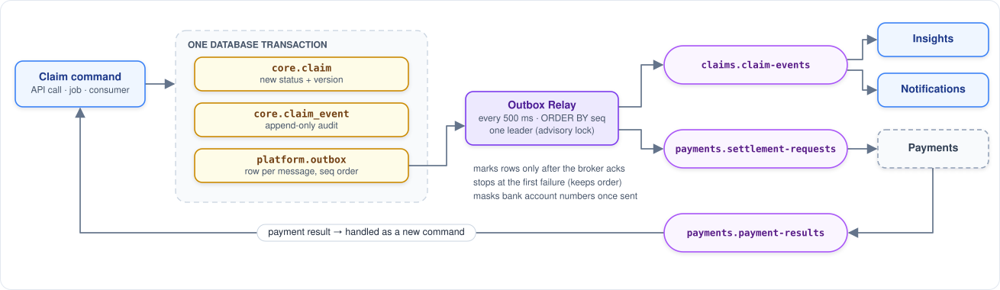

1. A command saves the claim row, an append-only `claim_event` row and an `outbox` row in **one transaction**.
2. The outbox relay runs every 500 ms on one instance (advisory lock). It publishes `ORDER BY seq`, marks a row only after the broker acknowledges it, and stops at the first failure to keep the order.
3. After a settlement request is published, the relay masks the bank account number in its outbox row.

Every topic is keyed by claim id, so the events of one claim stay in order.

#### Consumers

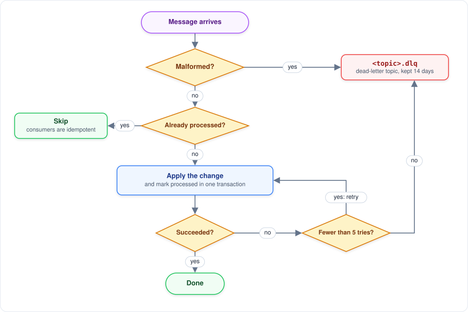

- Consumers are idempotent: they record `(consumer, message_id)` in `processed_event` in the same transaction as their change.
- A failing message is tried 5 times, then moved to `<topic>.dlq` (kept 14 days). A malformed message goes there straight away.
- Listeners take their group id from `spring.kafka.consumer.group-id`, never a hard-coded one.

### Data model

Each service owns a PostgreSQL database and migrates it with Flyway on startup. The diagram shows key columns only; the migrations in `src/main/resources/db/migration` are the full definition.

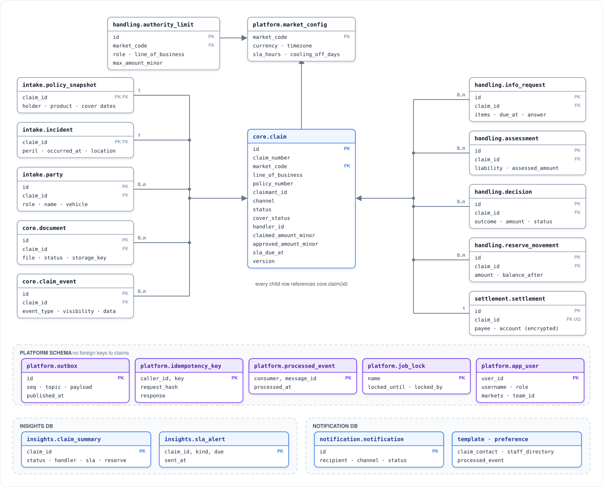

| Database · schema | Tables | Notes |
|---|---|---|
| claims · `core` | `claim`, `claim_event`, `document` | `claim.version` for optimistic locking; `claim_event` is append-only (trigger). |
| claims · `intake` | `policy_snapshot`, `incident`, `party` | Copied at reporting time, so later policy changes do not affect the claim. |
| claims · `handling` | `info_request`, `assessment`, `decision`, `reserve_movement`, `authority_limit` | `reserve_movement` is append-only. |
| claims · `settlement` | `settlement` | `account_number_enc` is encrypted with AES-256-GCM. |
| claims · `platform` | `market_config`, `outbox`, `idempotency_key`, `processed_event`, `job_lock`, `app_user` | Also the Flyway history. |
| insights | `claim_summary`, `sla_alert`, `processed_event` | One summary row per claim, folded from events. |
| notification | `notification`, `claim_contact`, `template`, `preference`, `staff_directory`, `processed_event` | Reference data is mapped with JPA (`ddl-auto=validate`). |

Money is stored as `*_amount_minor` (whole minor units) plus a currency code. Every schema change is a new migration in the owning service.

### Background jobs

Every scheduled task, how often it runs, how only one instance does the work, and what it changes.

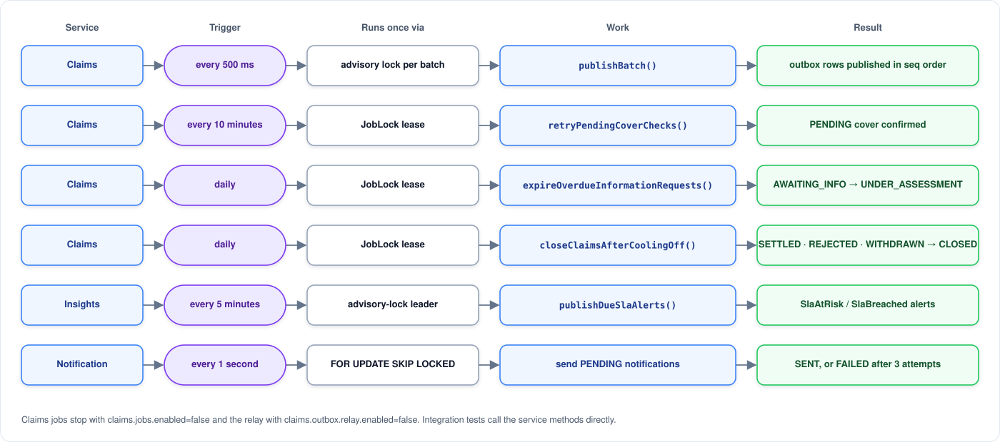

- Claims jobs take a lease in `platform.job_lock`; the outbox relay and the SLA job use advisory locks; the notification dispatcher uses `FOR UPDATE SKIP LOCKED`.
- A scheduler only triggers a service method. Integration tests call those methods directly.
- `claims.jobs.enabled=false` stops the claims jobs, `claims.outbox.relay.enabled=false` the relay.

## 6. Docker Setup

All Docker files are in `deployment/`; the full deployment guide is [`deployment/README.md`](deployment/README.md).

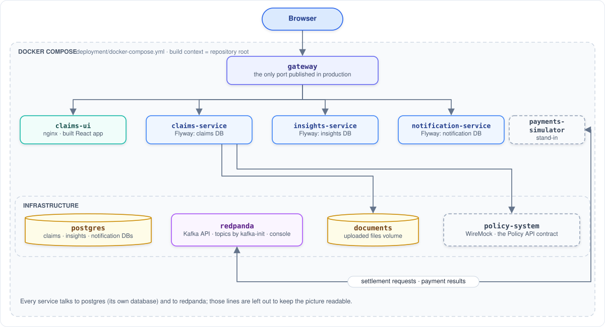

| Container | Built from |
|---|---|
| gateway, claims-service, insights-service, notification-service, payments-simulator | One shared `deployment/docker/service.Dockerfile`, one build per module |
| claims-ui | Node build served by nginx (`claims-ui/Dockerfile`) |
| policy-system | WireMock with the mappings in `deployment/docker/policy-system` (the Policy API contract) |
| postgres, redpanda, redpanda-console | Public images; `kafka-init` creates the topics and exits |

Production overlay: secrets come from `.env`, only the gateway is published, containers restart on their own. Put TLS in front of the gateway.

```sh
cd deployment
docker compose -f docker-compose.yml -f docker-compose.prod.yml up -d --build   # first start and every update (after git pull)
./smoke.sh                                                                     # end-to-end check
docker compose ps                                                              # kafka-init should be Exited (0)
docker compose logs -f gateway claims-service
```

## 7. Claim Lifecycle and Flows

### Report a claim

From sign-in to the first notification.

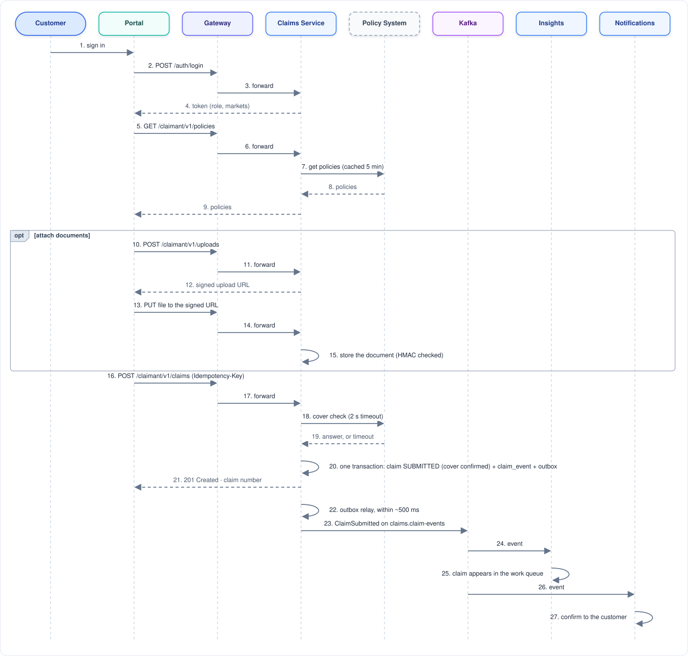

- Policies come from the Policy System, cached for 5 minutes.
- Documents are uploaded first, to a signed URL; the claim refers to them by upload id.
- The response does not wait for Kafka; `ClaimSubmitted` is published within about half a second.
- A claim manager can register a claim for a customer who phoned (`POST /staff/v1/claims`); it follows the same path.

### Assess and decide

From pick-up to the decision.

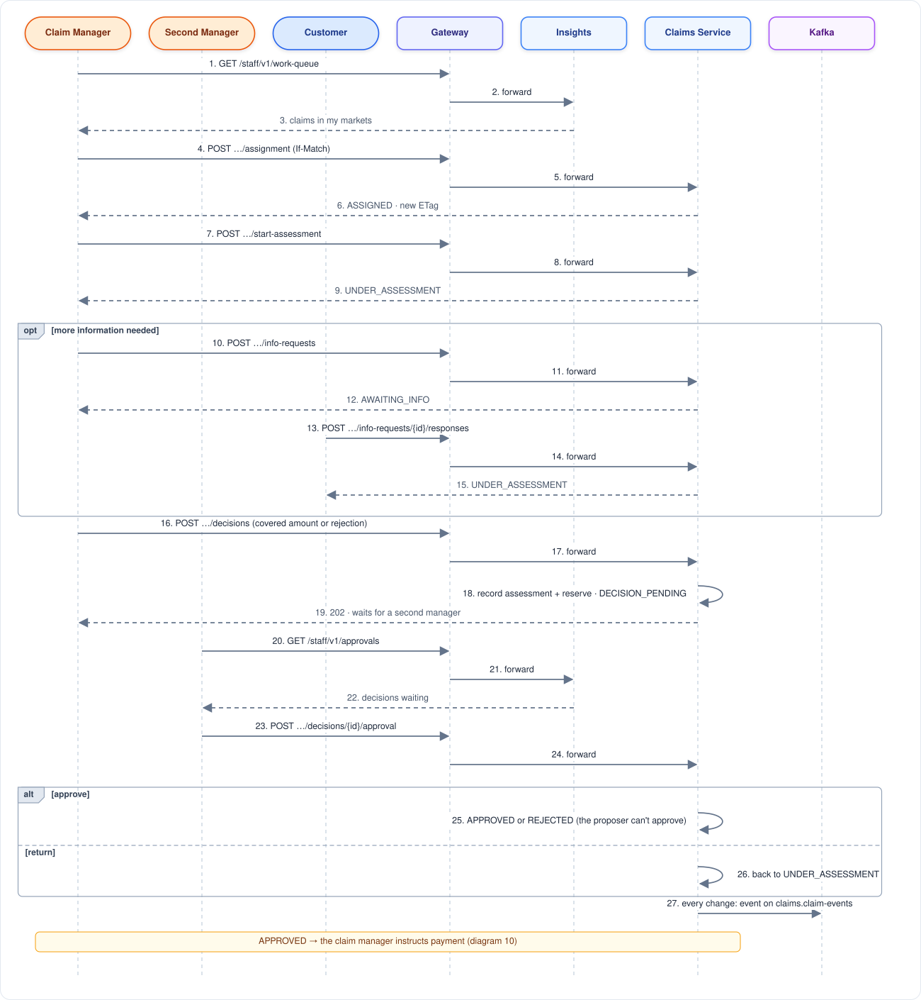

- Every staff change sends the claim version in `If-Match` (missing → 428, outdated → 412) and gets the new version back as `ETag`.
- Claim managers only see and change claims in their markets (`FORBIDDEN_MARKET` otherwise).
- The proposal records the assessment and sets the reserve. Full cover equals the claimed amount; partial cover is above zero and no more than it.
- Pending decisions appear in **Approvals** for the other claim managers, who approve or return them.

### Payments and settlement

How an approved claim is paid, and what happens when a payment fails.

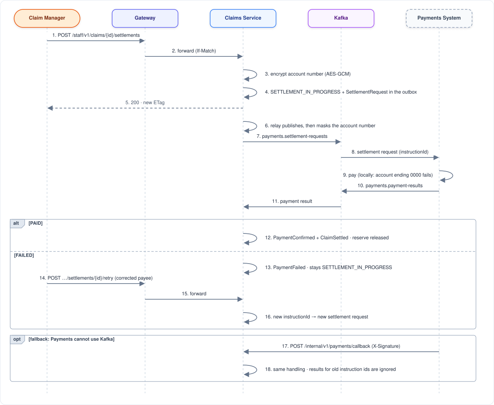

- The bank account number is encrypted (AES-256-GCM, `FIELD_ENCRYPTION_KEY`) before it is stored.
- Each attempt has its own `instructionId`; a result for an older attempt is ignored, so a late answer cannot undo a retry.
- Recording a result is idempotent, whether it arrives on Kafka or through the webhook fallback.
- Locally, an account number ending `0000` fails, so you can try the retry path.

## 8. Installation and Setup

```sh
git clone <repository-url>
cd claim-platform
```

The local stack needs no `.env`; the compose file supplies development secrets. For a server, create one and replace every secret before the first start:

```sh
cd deployment
cp .env.example .env
openssl rand -hex 32       # for each signing secret
openssl rand -base64 32    # for FIELD_ENCRYPTION_KEY
```

## 9. Configuration

Locally, services run with the `dev` profile (`SPRING_PROFILES_ACTIVE=dev`), which supplies the shared HS256 secret and the encryption key. Without them, services refuse to start. With `OIDC_ISSUER_URI` set, services validate tokens against that issuer instead, and the built-in login tokens no longer work.

| Variable | Purpose |
|---|---|
| `PUBLIC_BASE_URL` | Address users open, such as `https://claims.example.com`; upload links use it |
| `GATEWAY_PORT` | Host port of the gateway (default `8000`) |
| `DB_USER`, `DB_PASSWORD` | Database owner; applied when the database volume is first created |
| `JWT_SECRET` | Signs login tokens; shared by every service |
| `DOCUMENT_SIGNING_SECRET` | Signs upload URLs |
| `PAYMENTS_WEBHOOK_SECRET` | Checks the payments webhook |
| `PROVIDER_CALLBACK_SECRET` | Checks delivery receipts from message providers |
| `FIELD_ENCRYPTION_KEY` | Base64 of 32 bytes; encrypts bank account numbers. Losing it makes stored numbers unreadable |
| `RATE_LIMIT_AUTHENTICATED`, `RATE_LIMIT_ANONYMOUS` | Gateway requests per minute per client (defaults `300` and `60`) |

Secrets must be at least 32 characters. Never commit `.env`.

## 10. API Documentation

| Service | Swagger UI | OpenAPI document |
|---|---|---|
| Claims | http://localhost:8080/swagger-ui.html | http://localhost:8080/v3/api-docs |
| Insights | http://localhost:8081/swagger-ui.html | http://localhost:8081/v3/api-docs |
| Notification | http://localhost:8082/swagger-ui.html | http://localhost:8082/v3/api-docs |

Sign in, then paste `access_token` under **Authorize** in Swagger UI:

```sh
curl -s -X POST http://localhost:8000/auth/login \
  -H 'Content-Type: application/json' \
  -d '{"username":"priya","password":"ChangeMe123!"}'
```

- Staff changes send `If-Match` with the quoted `ETag` from the last `GET`.
- Money is `{ "amount": "12000.00", "currency": "SGD" }`.
- The gateway does not route the internal callbacks: payment results go to `POST :8080/internal/v1/payments/callback`, delivery receipts to `POST :8082/internal/v1/providers/{provider}/delivery-status`. Both are signed with `X-Signature: sha256=<HMAC-SHA256 of the raw body>`.
- The happy path, call by call, is in `bruno/` (Local environment) and `http/happy-path.http`.

## 11. Running the Application

Start everything (gateway, services, portal, PostgreSQL, Kafka, Policy and Payments stand-ins), then open http://localhost:8000:

```sh
cd deployment
docker compose up -d --build
./smoke.sh            # end-to-end check (bash; use Git Bash on Windows)
docker compose down   # stop; add -v to also delete the data
```

| Address | What it is |
|---|---|
| http://localhost:8000 | Gateway and portal |
| http://localhost:8080 / 8081 / 8082 | Claims / Insights / Notification services (Swagger UI) |
| http://localhost:8083 | Payments simulator |
| http://localhost:8089 | Policy System stub |
| http://localhost:8090 | Kafka console |
| localhost:5432 / localhost:19092 | PostgreSQL (user and password `claims`) / Kafka |

Every seeded account has the password `ChangeMe123!`. Customers: `priya`, `tan` (SG), `wong` (HK), `aisyah` (MY). Claim managers: `arun`, `kumar` (SG), `faiz` (MY), `meera` (SG, MY), `ho` (HK), `lee` (all markets).

Try it: as `priya`, report a claim on policy `SG-MTR-POL-1001`; as `arun`, pick it up and propose cover; as `meera`, approve; as `arun`, instruct payment. The claim becomes `SETTLED` when the payments simulator answers.

### Run from the IDE

```sh
docker compose -f deployment/docker-compose.yml up -d postgres redpanda kafka-init redpanda-console policy-system payments-simulator
SPRING_PROFILES_ACTIVE=dev ./mvnw -pl claims-service -am spring-boot:run   # repeat for insights-service, notification-service, gateway-service
cd claims-ui && npm install && npm run dev                                 # http://localhost:5173, proxies API calls to :8000
```

In PowerShell, set `$env:SPRING_PROFILES_ACTIVE='dev'` and use `.\mvnw.cmd`.

## 12. Testing

```sh
./mvnw test                     # unit tests (*Test)
./mvnw clean verify             # unit and integration tests (*Test, *IT); scripts/ci.sh runs the same
cd claims-ui && npm ci && npm test && npm run build
cd bruno && npx @usebruno/cli run "00 Happy path" --env Local --sandbox developer   # needs the running stack
```

Integration tests use PostgreSQL and Kafka from Docker when it is available, and an embedded database and broker when it is not. On Windows use `.\mvnw.cmd` and quote `-D` flags in PowerShell.

| Kind | What it covers |
|---|---|
| Unit (`*Test`) | State machine, reserves, authority, money, services |
| Controller (`*ApiTest`) | Endpoints, error bodies, security rules |
| Gateway | Routes, 401 and 403, rate limits, circuit breakers |
| Integration (`*IT`) | PostgreSQL and Kafka: repositories, outbox order, payments, jobs, read models |
| `deployment/smoke.sh`, `bruno/` | The business flow on the running stack |

## 13. Error Handling

Every service answers errors with `application/problem+json` (RFC 9457): a stable `code`, a `detail` and a `correlationId`, plus an `errors` array for field validation. Unexpected failures never include a stack trace.

| Situation | HTTP | `code` |
|---|---|---|
| Invalid body or field | 400 | `VALIDATION_FAILED` |
| Missing `Idempotency-Key` on claim submit | 400 | `IDEMPOTENCY_KEY_REQUIRED` |
| Unknown user or wrong password | 401 | `UNAUTHENTICATED` |
| Wrong role or market | 403 | `FORBIDDEN_ROLE`, `FORBIDDEN_MARKET` |
| Unknown claim, or someone else's | 404 | `CLAIM_NOT_FOUND` |
| Status does not allow the command | 409 | `CLAIM_INVALID_TRANSITION` |
| Outdated `If-Match` | 412 | `STALE_VERSION` |
| Missing `If-Match` on a staff change | 428 | `IF_MATCH_REQUIRED` |
| Unexpected failure | 500 | `INTERNAL_ERROR` |

## 14. Logging and Monitoring

- Every request carries a correlation id, in the logs and in error responses.
- Actuator runs on each service's management port, which Compose does not publish.
- Insights and notifications follow claims by a few seconds because they read Kafka; a missing dashboard row usually means the event is not applied yet.

## 15. Security

Sign-in, and the two checks every request passes: at the gateway and again in the service.

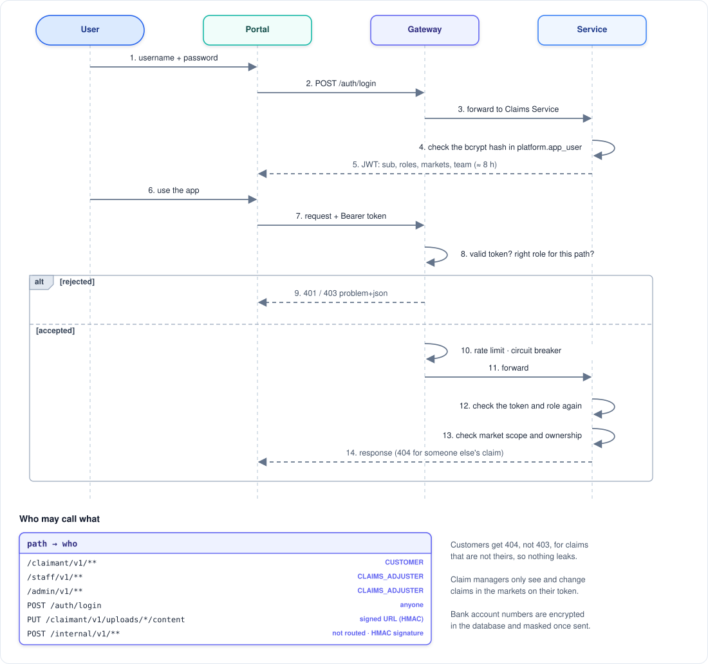

- `POST /auth/login` on claims-service checks a bcrypt hash in `platform.app_user` and issues an HS256 JWT (about 8 hours) with `sub`, `roles`, `markets`, `name`, `locale` and `team`.
- A customer token cannot call `/staff/**` or `/admin/**`; a claim manager token cannot call `/claimant/**`. Customers get 404 for claims that are not theirs.
- Upload URLs and internal callbacks are authorised by an HMAC signature, not a user token.
- Bank account numbers are encrypted at rest and masked once sent.
- The seeded passwords and the dev secrets are for local use only.

## 16. Troubleshooting

| What you see | What to do |
|---|---|
| Service exits on startup about a missing or short secret | Use the `dev` profile, or set `JWT_SECRET` to at least 32 characters |
| Tokens fail after setting `OIDC_ISSUER_URI` | Leave it empty when using the built-in login |
| HTTP 428 / 412 on a staff change | Read the claim again and send its `ETag`, quotes included, in `If-Match` |
| 409 `CLAIM_INVALID_TRANSITION` | The claim has moved on; refresh and use the current status |
| Claim stays `SETTLEMENT_IN_PROGRESS` | Check `payments-simulator` and Kafka; `kafka-init` must have exited 0 |
| New claim missing from a dashboard | Wait a few seconds; Insights applies events asynchronously |
| `/actuator/health` is 404 on port 8000 | Expected: Actuator is on the management port |
| Login: connection refused | Run `docker compose ps` in `deployment`; claims-service and the gateway must be up |

## 17. Future Enhancements

- Use a company identity provider when `OIDC_ISSUER_URI` is set, and stop issuing HS256 tokens in that mode.
- Add an administrator screen for accounts; today users come only from the Flyway seed.
- Publish Actuator metrics to a monitoring system.

## 18. Contribution Guidelines

1. Keep a change inside one service unless the event contract in `claims-common` has to change with it.
2. Keep `intake`, `handling` and `settlement` independent, and never call a repository from a controller.
3. Add a unit test for domain rules, and an `*IT` when persistence or Kafka behaviour changes.
4. Run `./mvnw clean verify`; for UI changes also `npm test` and `npm run build` in `claims-ui`.
5. When behaviour changes, update the matching README section and its SVG in `documents/images/` in the same change, and check the SVG in a browser.
6. Never commit `.env` or real secrets. Open a pull request that says what changed and how you tested it.

## 19. License

This repository does not include a `LICENSE` file. Add one before you distribute the code.
