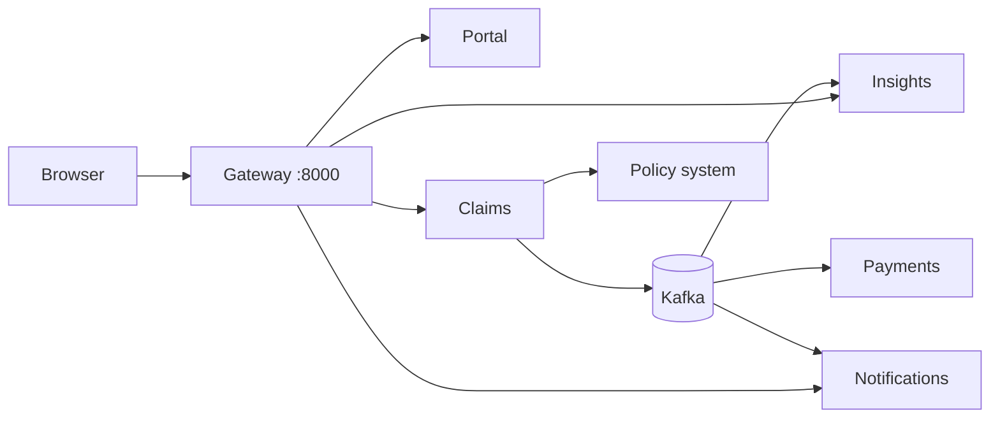

# Claims Platform

Customers report motor and property claims. Handlers assess them, team leads approve amounts above a limit, and a manager can see workload and reserves. The app covers Singapore, Hong Kong, Malaysia, Thailand, Indonesia, and Australia.

The public address is the gateway. Open **http://localhost:8000** after the stack is up.

Sign-in is `POST /auth/login`. Every seeded account uses the password `ChangeMe123!`. Change it before a real deployment.

| Username | Who |
|---|---|
| `priya`, `tan` | Customer, Singapore |
| `wong` | Customer, Hong Kong |
| `aisyah` | Customer, Malaysia |
| `arun`, `kumar` | Handler, Singapore |
| `faiz` | Handler, Malaysia |
| `meera` | Team lead, Singapore and Malaysia |
| `ho` | Team lead, Hong Kong |
| `lee` | Manager, all markets |

A handler can pick up a claim only after it is `TRIAGED`. A claim stays `SUBMITTED` while the Policy system has not answered. Policy `SG-MTR-POL-1500` is slow on purpose and leaves cover pending.

## What you need

| Task | Tools |
|---|---|
| Run the whole stack | Docker Engine 24+ and Compose v2 |
| Build and test the backend on the host | JDK 21. Maven is the `mvnw` wrapper in this repo |
| Build the UI on the host | Node 22 |

Java and Node are not required on a server. The Docker build installs them inside the images.

## Build

From the repository root.

**Backend** (compile, unit tests, and integration tests):

```sh
./mvnw clean verify
```

On Windows PowerShell:

```powershell
.\mvnw.cmd clean verify
```

Integration tests use PostgreSQL 16 and Kafka from Docker when Docker is available, and an embedded database and broker when it is not.

**UI** (type-check and production bundle in `claims-ui/dist`):

```sh
cd claims-ui
npm ci
npm test
npm run build
```

**Docker images** (backend, UI, and local stand-ins). This is also how a server build works:

```sh
cd deployment
docker compose build
```

## Run locally

One command builds the images and starts the gateway, the three services, the portal, PostgreSQL, Kafka, and the Policy and Payments stand-ins.

```sh
cd deployment
docker compose up -d --build
```

Open http://localhost:8000 and sign in.

| Address | What it is |
|---|---|
| http://localhost:8000 | Gateway and the portal |
| http://localhost:3000 | Portal container, if you open it directly |
| http://localhost:8080/swagger-ui.html | Claims API |
| http://localhost:8081/swagger-ui.html | Insights API |
| http://localhost:8082/swagger-ui.html | Notification API |
| http://localhost:8083 | Payments simulator. Account numbers ending `0000` fail |
| http://localhost:8089 | Policy system stand-in |
| http://localhost:8090 | Kafka console |
| localhost:5432 | PostgreSQL, user `claims`, password `claims` |
| localhost:19092 | Kafka for programs running on your machine |

Check that it works:

```sh
cd deployment
./smoke.sh
```

`smoke.sh` needs bash. On Windows, run it from Git Bash.

Stop the stack:

```sh
cd deployment
docker compose down
```

`docker compose down -v` also deletes the database, Kafka data, and uploaded files.

### Run from the IDE

Start only the infrastructure, then run a service with the `dev` profile. The `dev` profile supplies the local signing key. Without it, the service refuses to start.

```sh
docker compose -f deployment/docker-compose.yml up -d postgres redpanda kafka-init redpanda-console policy-system payments-simulator
```

```sh
SPRING_PROFILES_ACTIVE=dev ./mvnw -pl claims-service -am spring-boot:run
```

Do the same for `insights-service`, `notification-service`, and `gateway-service`. The gateway expects claims on port 8080, insights on 8081, notification on 8082, and the portal on port 3000.

On Windows PowerShell:

```powershell
$env:SPRING_PROFILES_ACTIVE='dev'
.\mvnw.cmd -pl claims-service -am spring-boot:run
```

Hot reload for the UI, with the gateway already on port 8000:

```sh
cd claims-ui
npm install
npm run dev
```

The Vite server is http://localhost:5173. It forwards `/auth`, `/claimant`, `/staff`, and `/admin` to the gateway.

### Try the business flow

1. Sign in as `priya` and report an incident on policy `SG-MTR-POL-1001`.
2. Sign in as `arun`. Open the work queue and pick up the claim once its status is `TRIAGED`.
3. Assess it and propose an approval of SGD 12,000. That is above Arun's limit, so the claim waits for a team lead.
4. Sign in as `meera` and approve it.
5. Sign in as `arun` again and instruct payment. The claim becomes `SETTLED` after the payments simulator answers.

The same steps are in the Bruno collection under `bruno/` (open that folder in Bruno and use the **Local** environment) and in `http/happy-path.http`.

## Deploy

Deploy from the `deployment` folder. Full notes, secret meanings, and troubleshooting are in [`deployment/README.md`](deployment/README.md).

```sh
cd deployment
cp .env.example .env
```

Fill in `.env` before the first start. Create the secrets with `openssl rand -hex 32`. Create the bank-account key with `openssl rand -base64 32`. Required values:

| Variable | Purpose |
|---|---|
| `PUBLIC_BASE_URL` | Address users open, such as `https://claims.example.com`. Upload links use it |
| `GATEWAY_PORT` | Host port for the gateway. Default `8000` |
| `DB_USER`, `DB_PASSWORD` | Database owner. Used when the database volume is first created |
| `JWT_SECRET` | Signs login tokens. At least 32 characters. Shared by every service |
| `DOCUMENT_SIGNING_SECRET` | Signs upload URLs. At least 32 characters |
| `PAYMENTS_WEBHOOK_SECRET` | Checks the payments fallback webhook. At least 32 characters |
| `FIELD_ENCRYPTION_KEY` | Encrypts bank account numbers. Keep this key. Losing it makes stored account numbers unreadable |
| `PROVIDER_CALLBACK_SECRET` | Checks e-mail, SMS, and push delivery receipts. At least 32 characters |

Start the production overlay. Only the gateway is published on the host. Containers restart on their own. Secrets come from `.env` instead of the local defaults.

```sh
cd deployment
docker compose -f docker-compose.yml -f docker-compose.prod.yml up -d --build
```

Put TLS in front of the gateway. The gateway itself speaks plain HTTP. Flyway creates and upgrades the database schemas when each service starts. There is no separate migration command.

Update a running server:

```sh
git pull
cd deployment
docker compose -f docker-compose.yml -f docker-compose.prod.yml up -d --build
./smoke.sh
```

Useful checks:

```sh
cd deployment
docker compose ps
docker compose logs -f gateway claims-service
```

`kafka-init` should show `Exited (0)`. That container only creates topics and then stops.

## How the pieces fit



* **Gateway** is the only public entry. It checks the token and the role, then forwards the call.
* **Claims** is the only service that changes a claim. A write saves the claim, the audit row, and an outbox row in one database transaction. A relay publishes the outbox to Kafka about half a second later.
* **Insights** builds the work queue, search, and dashboards from those events.
* **Notifications** turns events into inbox messages and e-mail, SMS, or push.

Customers call `/claimant/v1/**`. Handlers, team leads, and managers call `/staff/v1/**`. Managers also call `/admin/v1/templates`. Staff changes send `If-Match` with the claim version from the last read. A missing version is HTTP 428. A stale version is HTTP 412.

Claim path: `SUBMITTED` → `TRIAGED` → `ASSIGNED` → `UNDER_ASSESSMENT` → decision → `APPROVED` or `REJECTED` → payment → `SETTLED` → `CLOSED`. A customer can withdraw before a decision, and can appeal a rejection.

Swagger on each service lists every endpoint. The gateway routes are the ones the browser and Bruno should call.

## Project layout

| Folder | What it is |
|---|---|
| `gateway-service` | Public entry point: routing, token and role checks, rate limits, circuit breakers |
| `claims-service` | Claims, sign-in, document uploads. Modules `core`, `intake`, `handling`, `settlement`, `platform` |
| `insights-service` | Work queue, search, approvals, dashboards, built from claim events |
| `notification-service` | Inbox, preferences, templates, e-mail / SMS / push |
| `payments-simulator` | Stand-in for the Payments system |
| `claims-common` | The one shared library: event and payment contracts, web and security plumbing, Kafka consumer policy, test helpers |
| `claims-ui` | Customer and staff portal (React, Vite, TypeScript) |
| `deployment` | Compose files, production overlay, `.env.example`, image recipe, smoke test, deployment guide |
| `bruno`, `http` | API collections that walk the business flow |
| `.claude` | Instructions and review agents for Claude Code |

Every backend service uses the same layered packages, with interfaces separated from implementations:

| Package | Holds |
|---|---|
| `controller` | REST endpoints. They map HTTP to a service call and nothing else |
| `service`, `service.impl` | One interface per service and its `...ServiceImpl` |
| `repository`, `repository.impl` | One interface per repository and its JDBC or JPA implementation |
| `entity` | Business objects and their rules, such as the `Claim` state machine |
| `dto.request`, `dto.response` | One record per request or response body |
| `mapper` | Conversion between entities and DTOs |
| `producer`, `consumer` | Outgoing and incoming Kafka messages |
| `client`, `cache`, `scheduler` | Calls to external systems, in-memory caches, timed jobs |
| `config`, `exception`, `common` | Spring configuration, error handling, shared helpers |

A request goes controller → service → repository. Controllers never call a repository, and code depends on a service or repository interface, never on its implementation class.

## API documentation

Each service publishes OpenAPI 3 documentation with Swagger UI. Every endpoint lists its parameters, request and response bodies, and each HTTP status it can return. Errors use one format on every service: `application/problem+json` with a stable `code` and a `correlationId`.

| Service | Swagger UI | OpenAPI document |
|---|---|---|
| Claims | http://localhost:8080/swagger-ui.html | http://localhost:8080/v3/api-docs |
| Insights | http://localhost:8081/swagger-ui.html | http://localhost:8081/v3/api-docs |
| Notification | http://localhost:8082/swagger-ui.html | http://localhost:8082/v3/api-docs |

In Swagger UI, sign in with `POST /auth/login`, copy `access_token`, and paste it under **Authorize**.

## Tests

```sh
./scripts/ci.sh          # same as CI: ./mvnw -B -ntp verify
./mvnw test              # unit tests only
```

On Windows, `scripts/ci.sh` needs Git Bash. The Maven command is `.\mvnw.cmd -B -ntp verify`.

The UI is not part of the Maven build. After UI changes, run `npm test` and `npm run build` in `claims-ui`.

| Kind | What it covers |
|---|---|
| Unit (`*Test`) | Claim state machine for every command in every status, reserve ledger, authority limits, money, service implementations with JUnit 5 and Mockito |
| Controller (`*ApiTest`) | Every endpoint, every error response, and the security rules |
| Gateway | Routing table, 401 and 403 rules, rate limits, circuit breakers, header rewriting |
| Integration (`*IT`) | Real PostgreSQL and Kafka: repositories, outbox ordering, payment results, background jobs, read models, notification dispatch |
| Whole stack (`deployment/smoke.sh`) | 25 steps through the gateway against the running Docker stack, from sign-in to a settled claim |
