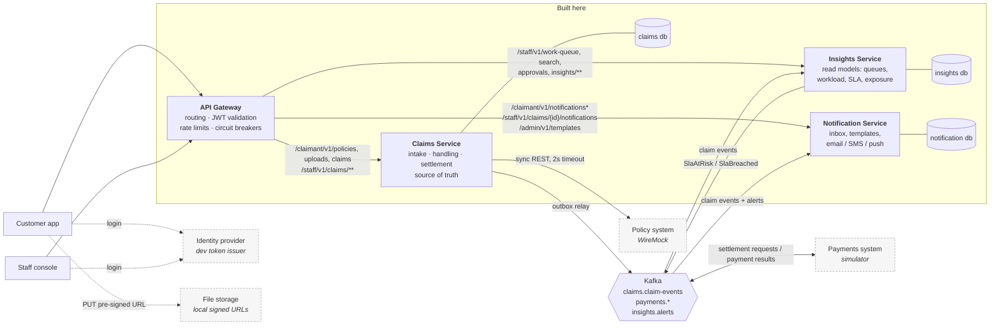
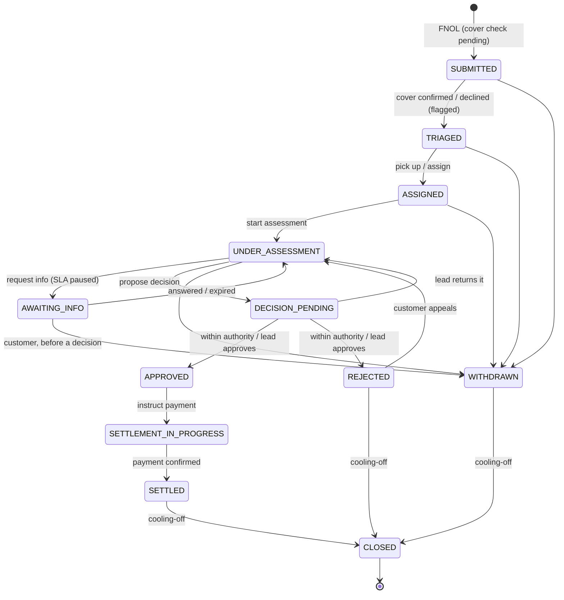
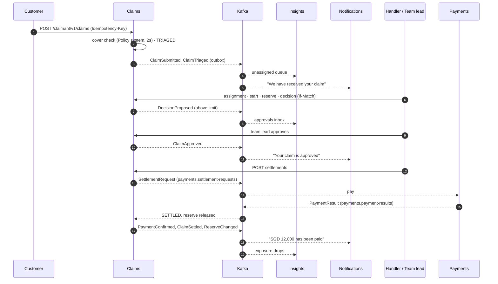

# Claims Platform

Backend for an insurer processing **MOTOR** and **PROPERTY** claims across six APAC markets (SG, HK, MY, TH, ID, AU — configurable).
Customers report incidents (FNOL), track them and answer information requests; claims handlers assess, reserve, decide and settle;
team leads approve decisions above a handler's authority and watch workload, SLAs and money at risk.

Java 21 · Spring Boot 3.4 · PostgreSQL 16 · Flyway · Kafka (Redpanda locally) · JUnit 5 · AssertJ · Testcontainers · ArchUnit · springdoc-openapi · Maven · docker-compose

---

## Architecture



* **Only Claims changes a claim.** Insights and Notifications only listen to Kafka and read; if either is down, claims still go through.
* Every write API answers synchronously. The event it produces is stored in the **same transaction** (`claim_event` audit row + `outbox` row) and published by the outbox relay (~500 ms), so APIs never wait for Kafka.
* All messages are keyed by `claimId`, so the events of one claim stay in order.
* The **API Gateway** (`gateway-service`, Spring Cloud Gateway Server MVC) is the only public entry point: it routes by path, rejects requests without a valid token or with the wrong role for the surface, rate-limits per client, puts a circuit breaker in front of each service and normalises headers. It holds no business rules and no database.

### Inside each service: clean architecture

```
<module>/domain          plain Java: aggregates, rules, value objects (zero framework imports)
<module>/application     use cases (one small class each) + ports
<module>/infrastructure  JDBC/JPA, Kafka, REST adapters, Spring wiring
<module>/api             controllers + DTOs (separate claimant / staff DTOs)
```

The gateway is the exception: it has no domain, so it is one flat package (`Routes`, `GatewaySecurityConfig`, `RateLimiter`, `UpstreamBreakers`, `EdgeHeaders`).

Claims Service is a modular monolith: `core` (Claim aggregate, state machine, reserve ledger), `intake`, `handling`, `settlement`, `platform`.
`intake`, `handling` and `settlement` never depend on each other. Each module has its own Postgres schema. These rules are enforced by
an `ArchitectureTest` in every service (shared rules in `claims-architecture`, which has its own tests proving each rule catches a violation).

### Claim lifecycle



The table lives only in `ClaimStatus`; `Claim` is the only code that changes status. Invalid transitions throw a domain exception
(`CLAIM_INVALID_TRANSITION`, HTTP 409). `ClaimStatusTest` checks all 144 status pairs against an independent copy of this diagram and
`ClaimCommandMatrixTest` runs every command in every status.

### End-to-end flow



---

## Key rules

| Topic | Rule |
|---|---|
| Money | `amountMinor` (long) + ISO currency; never mixed; minor digits from `java.util.Currency`. |
| Reserves | Append-only `reserve_movement` ledger (DB trigger forbids UPDATE/DELETE); outstanding exposure = sum of movements; released on settle / reject / withdraw. |
| Authority | Limits per role × market × LOB (`handling.authority_limit`). Within the proposer's limit the decision is final (200); above it, it waits for a team lead (202). The proposer can't approve their own decision; an approver above their own limit gets `AMOUNT_EXCEEDS_AUTHORITY` (escalate to a manager). Rejections are checked against the outstanding reserve. |
| SLA | Market SLA from submission to decision; paused while awaiting the customer; Insights alerts at < 4 h and on breach. |
| Cover check | Policy system unavailable → claim saved as SUBMITTED with cover PENDING; retried every 10 min. Declined cover → triaged and flagged for a handler. |
| Idempotency | `Idempotency-Key` on claim submission (replays return the original result; different body → 422). Consumers dedupe on `processed_event`. |
| Concurrency | Staff state changes need `If-Match: "<version>"` (428 if missing, 412 if stale); a pick-up race gives the loser 409 `CLAIM_ALREADY_ASSIGNED`. |
| Errors | RFC 9457 `application/problem+json` with a stable `code` and the `correlationId`, from one handler per service. The gateway answers in the same shape: `UNAUTHENTICATED` 401, `FORBIDDEN` 403, `ROUTE_NOT_FOUND` 404, `PAYLOAD_TOO_LARGE` 413 (> 20 MB), `RATE_LIMITED` 429 (+ `Retry-After`), `UPSTREAM_UNAVAILABLE` 503. |
| Edge | Rate limit per client per minute: 300 per token `sub`, 60 per IP for token-less calls (`RATE_LIMIT_AUTHENTICATED` / `RATE_LIMIT_ANONYMOUS`). One circuit breaker per service: opens when half of the last 20 calls could not connect, timed out or answered 502/503/504, stays open 10 s; nothing is retried. `X-Forwarded-*` from callers is discarded and rewritten. |
| Visibility | Claimants only see their own claims (others are 404) and never see reserves, notes, internal events or handler ids. Staff queries are scoped to the token's `markets`. |
| Tracing | `X-Correlation-Id` is accepted or minted at the gateway, put in every log line (JSON, PII masked), outbox header and event envelope. |

## APIs

All APIs are documented by springdoc at `/swagger-ui.html` on each service.

* **Claims** — claimant C1–C10: `GET /claimant/v1/policies`, `POST /claimant/v1/uploads`, `POST|GET /claimant/v1/claims`, `GET /claimant/v1/claims/{id}`, `/timeline`, `/info-requests`, `POST .../info-requests/{rid}/responses`, `/withdraw`, `/appeal`.
  Staff S1–S12: `POST /staff/v1/claims`, `GET /staff/v1/claims/{id}`, `/audit`, `POST .../assignment`, `/start-assessment`, `/reserves`, `/info-requests`, `/assessments`, `/decisions`, `/decisions/{did}/approval`, `/settlements`, `/settlements/{sid}/retry`.
  Internal: `POST /internal/v1/payments/callback` (signed fallback if Payments can't use Kafka).
* **Insights** — `GET /staff/v1/work-queue?view=unassigned|mine|team`, `/staff/v1/search`, `/staff/v1/approvals`, `/staff/v1/insights/workload|performance|sla|exposure`.
* **Notifications** — `GET /claimant/v1/notifications`, `POST /claimant/v1/notifications/{id}/read`, `GET|PUT /claimant/v1/notification-preferences`, `GET /staff/v1/claims/{id}/notifications`, `GET /admin/v1/templates`, `PUT /admin/v1/templates/{id}`, `POST /internal/v1/providers/{provider}/delivery-status`.

## Kafka

| Topic | Producer | Consumers | Partitions / retention |
|---|---|---|---|
| `claims.claim-events` | Claims (outbox) | insights-service, notification-service | 12 / 30 d |
| `payments.settlement-requests` | Claims (outbox) | Payments | 6 / 30 d |
| `payments.payment-results` | Payments | claims-service | 6 / 30 d |
| `insights.alerts` | Insights | notification-service | 3 / 7 d |
| `<topic>.dlq` | any consumer after 5 failed attempts | support / replay | same / 14 d |

---

## Running locally

Requirements: JDK 21, Docker (for the full stack). Maven comes via `./mvnw`.

```sh
docker compose up -d --build            # everything; gateway on http://localhost:8000
```

| Service | Port | Notes |
|---|---|---|
| gateway (`gateway-service`) | 8000 | Spring Cloud Gateway with the routing table above; proxies `/` to the **claimant portal**. Health on its management port 8001 (not published) |
| claims-ui | 3000 | claimant portal (React + Vite, nginx); use it via the gateway at http://localhost:8000 |
| claims / insights / notification | 8080 / 8081 / 8082 | Swagger UI at `/swagger-ui.html` |
| payments-simulator | 8083 | account numbers ending `0000` fail |
| policy-system (WireMock) | 8089 | `SG-MTR-POL-1500` answers after 3 s → cover pending |
| Redpanda / console | 19092 / 8090 | |
| PostgreSQL | 5432 | user `claims` / `claims`; databases `claims`, `insights`, `notification` |

Infra only, services from the IDE: `docker compose up -d postgres redpanda kafka-init redpanda-console policy-system payments-simulator`,
then run each service with the `dev` profile (`SPRING_PROFILES_ACTIVE=dev ./mvnw -pl claims-service -am spring-boot:run`; same for `gateway-service`, which expects the services on localhost:8080–8082 and the portal on :3000).

**Logging in:** the identity provider is stood in by `POST /dev/token {"username": "priya"}` (claims-service, `dev` profile only).
Personas: customers `priya`, `tan` (SG), `wong` (HK), `aisyah` (MY), `somchai` (TH), `budi` (ID), `olivia` (AU), each with a motor and a property policy;
handlers `arun`, `kumar` and team lead `meera` (SG Motor), manager `lee` (all markets), plus a handler and team lead per other market
(`chan`/`ho`, `faiz`/`lim`, `niran`/`ploy`, `dewi`/`agus`, `jack`/`emma`).

**Claimant portal:** open http://localhost:8000, sign in as `priya`, report an incident and follow it (see [`claims-ui/README.md`](claims-ui/README.md); `cd claims-ui && npm run dev` for hot reload on :5173).

**Walk the whole happy path:** open [`http/happy-path.http`](http/happy-path.http) in IntelliJ / VS Code REST Client and run the requests top to bottom.

## Testing

```sh
./scripts/ci.sh        # = ./mvnw -B -ntp verify : unit, slice, ArchUnit, integration and cross-service tests
./mvnw test            # fast: unit / slice / ArchUnit only
```

* **Unit**: exhaustive state machine (`ClaimStatusTest`, `ClaimCommandMatrixTest`), authority policy, reserve ledger, money, projections, notification rules.
* **Slice**: `@WebMvcTest` for every controller, including every error response and the security rules.
* **Gateway**: the real gateway on a random port in front of WireMock upstreams — every row of the routing table, 401/403 rules, rate limits, circuit breakers and header rewriting.
* **Integration** (`*IT`): real PostgreSQL 16 and Kafka — repositories, outbox relay ordering, payment-results consumer + DLQ, background jobs, Insights read models, Notifications dispatch/retry. Uses Testcontainers when Docker is available (CI enforces it with `REQUIRE_DOCKER=1`) and falls back to embedded PostgreSQL / an in-JVM Kafka broker otherwise, so they always run.
* **Cross-service** (`e2e-tests`): starts the packaged jars of all four services as processes and walks a claim from FNOL to settlement (customer inbox, approvals inbox and exposure included).

---

## Trade-offs and decisions

| Decision | Why | Cost |
|---|---|---|
| Modular monolith for Claims | One transaction for claim + audit + outbox; the aggregate stays consistent. Modules can be split later along their schemas. | One deployable for three teams' worth of logic. |
| JDBC for the write model, JPA only for simple reference data | JDBC where SQL is the design: the Claim aggregate (version check, append-only ledger/events, outbox order in one transaction), outbox relay and job locks (advisory locks), notification dispatcher (`FOR UPDATE SKIP LOCKED`), Insights aggregates. Spring Data JPA for notification-service preferences, templates and staff directory (one-table CRUD). Entities live in infrastructure and map to domain records, so the domain stays annotation-free. | Two persistence styles in one service; more hand-written mapping on the JDBC side. |
| Transactional outbox + single-leader relay | No dual writes; per-claim order preserved (`seq`, advisory lock). | Publishing is ~0.5 s behind; a stuck message holds back later ones until it goes (chosen: order over availability). |
| Insights as read models | Heavy dashboard queries never touch the Claims database. | Data is a few seconds stale; read models must be rebuildable by replaying events. |
| Notifications plan in the consumer, send in a dispatcher | A slow/down provider never slows consumption or Claims; retries with backoff, then FAILED. | One more moving part (dispatch job). |
| SLA alerts published directly (no outbox) | Alerts are derived and recomputable; deterministic event ids make re-sends recognisable. | A crash between send and log can re-send an alert (deduped downstream). |
| Own the gateway: Spring Cloud Gateway Server MVC instead of an nginx stand-in | Edge logic in Java next to the services: central JWT validation, per-client rate limits, circuit breakers, header rewriting. The servlet (MVC) flavor reuses the shared `claims-web` plumbing (JWT decoder, problem+json, correlation ids, masked logs) and virtual threads; the reactive flavor would need all of that rewritten and Redis for its rate limiter. | A fourth deployable to build, run and patch. |
| Gateway validates JWTs and every service validates them again | Defence in depth: a service reached without the gateway is still safe. The gateway does the coarse check (surface × role); ownership and market scoping stay in the services. | Each token is verified twice (cheap, HS256/JWKS). |
| Rate-limit buckets in gateway memory | No new infrastructure. | Each gateway instance enforces its own quota; share them through a distributed Bucket4j store (e.g. Redis) before running several instances. |
| Dev token issuer instead of a real IdP locally | Testable locally and in CI. Production uses `OIDC_ISSUER_URI` (JWKS). | Not exercising real OTP/SSO flows. |
| Local file storage with signed URLs | Same contract as S3 pre-signed PUTs; MinIO images are no longer published on Docker Hub. | Swap the `DocumentStorage` adapter for S3 in real environments. |
| Bank account numbers encrypted in the app (AES-256-GCM, `FIELD_ENCRYPTION_KEY`) | Stored as `v1:<ciphertext>` bound to the settlement id; the outbox copy is masked to the last 4 digits once Payments has it; masked in logs and staff views. | Key comes from an env var: move to KMS/HSM envelope encryption and add key rotation (`v2:` prefix). Rows written before V7 stay plaintext until re-saved. |
| Templates in English, Simplified + Traditional Chinese (`zh`, `zh-Hant` for HK), Malay, Thai, Indonesian | One customer language per market; staff templates English. Lookup falls back `zh-Hant` → `zh` → `en`. | Translations are machine-quality placeholders for review by local teams. |

## What is simulated

Identity provider (dev token issuer), Policy system (WireMock, `docker/policy-system`), Payments system (`payments-simulator`), e-mail/SMS/push providers (fake providers in notification-service; e-mail containing `fail` or phone ending `0000` errors), file storage (local filesystem with HMAC-signed URLs).
